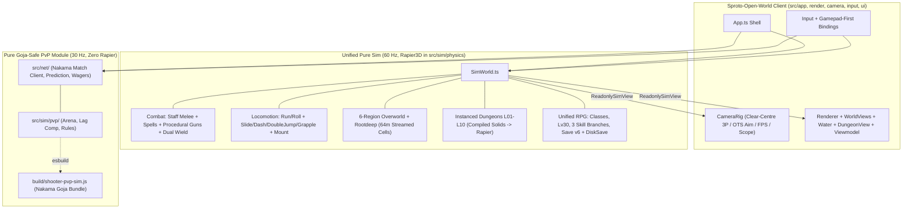

# Sproto Open World + Sproto Shooter Unification Plan

**Status:** Proposal for review (2026-11-20 — **synced with latest `main` including PRs #41, #44, #46, #48, #49**)  
**Target Repository:** `Sproto-Open-World` (flagship base; TypeScript, Three.js, Rapier3D, Vite)  
**Source Repository:** `sproto-shooter` (plain ESM JS; procedural gun engine, dual wield, movement tech, remaining enemies/bosses, 10 campaign levels `L01–L10`, and Free 1v1 PvP migrated into `Sproto-Open-World`)

---

## 0. What Already Landed on `main` (Baseline Delta)

Recent PRs on `Sproto-Open-World` `main` already built major foundations that this plan now builds directly on top of (avoiding duplicate work):

| Landed on `main` | Key Files | Impact on Unification Plan |
|---|---|---|
| **Class System + Initial 7 Guns (PR #41)** | `src/content/classes.ts`, `src/audio/gunSfx.ts`, `src/render/views/PlayerView.ts`, `src/assets/manifest.ts` | Three classes (`wizard`, `soldier`, `pepe`), rigged `soldier.glb` & `pepe_player.glb` with `GUNNER_CLIPS` (`shoot`, `aim`) + `socket_weapon`, all **7 core gun GLBs** (`gun_mg`, `gun_shotgun`, `gun_sniper`, `gun_bazooka`, `gun_raygun`, `gun_bigbullets`, `gun_duckgun` with `muzzle` nodes), and WebAudio `gunSfx.ts` are **already in SOW**! Currently guns are static `ItemDef`s firing via the `'gunfire'` spell slot with infinite ammo and class-locked `canWield()`. |
| **6-Region Walkable Overworld + Water (PR #46)** | `src/content/world/regions.ts`, `world-src/overworld.json`, `src/world/Water.ts` | The overworld is now **1536 × 2560 m** across **6 seamless regions** — **Sproutvale**, **Bellmere** (`town`), **Maple Terraces** (`zen`), **Willowrun** (`river`), **Frostspine** (`mountains`), and **Veilfalls** (`waterfalls`) — plus **Rootdeep** (`[64, 0]`). We can distribute the `L01–L10` dungeon portals and mixed Shooter encounters across all 6 biomes instead of crowding Sproutvale! |
| **Camera Clear-Centre (PR #48)** | `src/camera/CameraRig.ts`, `tests/camera/clearCentre.test.ts` | `CameraRig` already keeps the centre aim ray clear of the player and 2× Pepe Bull (`CameraOccluder`, `clearMargin: 0.35`). Our 3P OTS aiming, Sniper zoom, and FPS toggle extend this cleanly. |
| **Save v5, `DiskSave` & `dataEpoch` (PR #41, #44)** | `src/save/schema.ts`, `DiskSave.ts`, `dataEpoch.ts`, `tests/save/fixtures/save-v5.json` | `SAVE_SCHEMA` is already **`5`** (with `player.class` and local dev disk saves). Our unification migration is now **`SAVE_SCHEMA = 5 → 6`**. |
| **Imported Shooter Enemies & Bosses** | `src/assets/manifest.ts` | `brute` (`sproto_monster`), `gatekeeper` (`monster`), `robot_shooter`, `robot_laser`, `scrapjaw` (`car_monster`), `burrowmother` (`mole_monster`), and `drake` (`dragon`) are **already imported**. Only `midget_stage3`, `obama_stage3`, `sahil_stage2..3`, `tinubu_stage1..3`, `grappler.glb`, missing projectiles/pickups, and the 280 dungeon kit props remain to import. |

---

## 1. Locked Design Decisions

| Area | Decision |
|---|---|
| **Base & Repo Strategy** | `Sproto-Open-World` becomes the single flagship game. All ported systems live in `Sproto-Open-World` in strict TypeScript. A later `metaverse-hub` migration retires/redirects the standalone `sproto-shooter` plaza ring. |
| **Classes & Weapon Access** | **Anyone can wield anything** (lift `canWield`'s weapon lock so all 4 classes — **Wizard Sproto**, **Soldier Sproto**, **Pepe Warrior**, and **Pepe** — can mix Staves, Greatswords, and Guns across the 4-slot weapon bar). **Class changes your skills**: each class has its own innate passive, signature skill specialization, and 6 class-tailored milestone perks across all 3 skill branches. |
| **Camera & Gunplay** | Third-person over-the-shoulder (OTS) aiming (extending PR #48's clear-centre camera) with an optional **FPS toggle** and 2-stage **Sniper scope zoom**. |
| **Weapon Bar & Dual Wield** | **4-slot quick-swap weapon bar** where any slot can hold a Staff/Greatsword or a Gun. Pairing two sidearms (`handgun`, `machinepistol`) enables **Dual Wield**. |
| **Spells & Elements** | Keep **SOW's current spell list only** (no extra Shooter spells). Port Shooter's elements (**Fire**, **Shock**, **Goo**) onto guns and unify them with SOW's elemental statuses/weaknesses. |
| **Progression & Skills** | Raise level cap **15 → 30**, add a 3rd skill branch (**Gunslinger** alongside **Magic** & **Combat**), give each class distinct **class-specific skills & rank 10/20 perks**, and unify economy/saves on SOW (Sprouts, Tonics, Shrines, cloud/`DiskSave`) while upgrading guns from static infinite-ammo spells to **procedural loot with ammo & reloads**. |
| **Movement Tech** | Unlock progressively as RPG gear/relics/skills (**Slide & Dash** early; **Double-Jump & Grapple** mid-game) so overworld exploration and the Pepe Bull stay balanced, while Campaign dungeons introduce/test them naturally. |
| **Death / Revive** | **Eliminate Second Wind (kill-to-revive).** Use SOW's clean Shrine / dungeon checkpoint respawn loop. |
| **10 Created Levels (`L01–L10`)** | Ported as **instanced portals/dungeons** placed thematically across the **6 overworld regions + Rootdeep** (plus Brick Phone fast-travel), preserving each level's authored geometry, lighting, skybox, and mechanisms. Paced across early, mid, and endgame progression. |
| **Enemies, Bosses & Loot** | **Fully mix** Shooter enemies (Midgets, Bitcoin Obamas, Flying Midgets, Big Obamas, Bots, etc.), bosses, and procedural gun drops across all overworld camps/regions, as well as inside `L01–L10`. |
| **Included Modes** | Procedural loot guns + Dual Wield, 10-level Campaign (`L01–L10`), Movement Tech, and **Free 1v1 PvP** (Nakama authoritative arena & wagers). *(Wave Mode and standalone Boss Rush/Test Range are excluded; SOW already has `?sandbox=1` and `?yard=1`.)* |

---

## 2. Target Architecture

### Core Constraint: Rapier3D vs. Nakama Goja

`Sproto-Open-World` runs on **Rapier3D WASM** (`@dimforge/rapier3d-compat`, isolated to `src/sim/physics/PhysicsWorld.ts`), while `metaverse-hub` runs Free 1v1 PvP verification inside **Nakama's Goja JS runtime (ES2020 pure JS, no WASM)**.

1. **Overworld (6 regions + Rootdeep) & `L01–L10` Dungeons** all run inside SOW's unified `SimWorld` + `PhysicsWorld` (Rapier3D) at 60 Hz, obeying `tests/architecture.test.ts` (zero Three.js, DOM, timers, or `Math.random` in `src/sim` and `src/content`).
2. **Free 1v1 PvP** lives in a self-contained, zero-Rapier pure module `src/sim/pvp/` (30 Hz) that shares pure gun/ballistic/locomotion constants (`src/content/guns.ts`, `src/content/gameplay.ts`) and compiles via `esbuild` (`npm run build:pvp-sim`) into `build/shooter-pvp-sim.js` for Nakama Goja.

---

## 3. Combat, Camera & Controls Unification

### 3.1 Camera Modes (`src/camera/CameraRig.ts`)
Build on top of PR #48's `CameraOccluder` clear-centre logic (keeping `tests/camera/clearCentre.test.ts` green) with four seamless states:
1. **Exploration / Melee (Default 3P)**: Current `distance: 4.6`, `height: 1.95`, `shoulder: 0`, `fov: 62`, with clear-centre over player & 2× Pepe Bull.
2. **Gun Hip-Fire (3P OTS)**: Right-shoulder offset (`shoulder: 0.55`, `distance: 3.4`) when a gun is active so the reticle is cleanly unobstructed.
3. **Gun ADS / Zoom (3P OTS Tight or Scope)**: Tighter shoulder (`distance: 1.9`, `shoulder: 0.65`, `fov: 46` or gun's `zoomFov`). For **Sniper**, clicking zoom cycles Zoom 1 → Zoom 2 (`SCOPE_ZOOM2 = 1/3`) with a 2D scope overlay.
4. **Optional First-Person Toggle**: Moves camera to `eyeHeight` (`1.6m` standing, `0.72m` sliding), hides the player body mesh, and renders the ported `Viewmodel` (`gunMesh` / dual-wield hands / staff first-person pose).

> [!NOTE]
> `CameraRig.aimRay()` already feeds `InputCommand.aim` into `SimWorld`. In 3P OTS, shots fire from the gun's `muzzle` node toward the exact world point hit by `aimRay()` (parallax-corrected via `PhysicsWorld.raycast`).

### 3.2 Upgrading PR #41's Guns → 4-Slot Weapon Bar & Dual Wield
PR #41 introduced `GUN_ITEMS` as static `staff`-slot items that fire via the `'gunfire'` spell slot. We evolve this cleanly into the full unified weapon system:
- **4-Slot Weapon Bar**: Replace single `equipment.staff: ItemId` with `equipment.weapons: [WeaponSlot | null, WeaponSlot | null, WeaponSlot | null, WeaponSlot | null]` + `activeWeaponSlot: 0..3`.
  - Any slot can hold a **static melee/utility item** (Staff, Rootcleaver, Brick Phone) or a **procedural `GunInstance`** (`uid` in `Progress.guns`).
  - Lift `canWield`'s hard class lock so all 4 classes (**Wizard Sproto**, **Soldier Sproto**, **Pepe Warrior**, and **Pepe**) can mix Staves, Greatswords, and Guns freely, while preserving each class's starting kit (`CLASSES`), body model (`player` / `player_soldier` / `player_pepe_warrior` / `player_pepe`), and class flavor.
- **Retire `'gunfire'` as a Spell Slot**: Firing a gun moves from the spell hotbar (`'gunfire'`) onto Primary Fire (`LMB` / `RT`), freeing all 4 spell slots for real SOW spells on every class!
- **Dual Wield**:
  - Add `handgun` and `machinepistol` (`dualWield: true`) alongside the 7 already-imported gun types.
  - Pairing two sidearms alternates hands (`gap = 0.5 / fireRate`), independent mags/reloads, disables ADS/zoom, and stows cleanly on slot switch.
- **Gear Lock**: Swapping *between* your 4 equipped slots is always allowed in combat (with gun `swapTime`). Editing which items sit in the 4 slots in the Gear menu keeps SOW's 5-second combat gear-lock rule (free at Shrines).

### 3.3 Gamepad-First Controls (`src/input/bindings.ts`, `src/sim/commands.ts`)
SOW requires **100% gamepad playability** (verified by Playwright E2E, including the class picker added in PR #41). We use context-sensitive weapon actions based on whether the active slot is a **Staff/Melee** or a **Gun**:

| Action | Keyboard & Mouse | Gamepad (Standard) | Notes |
|---|---|---|---|
| **Primary Fire / Heavy** | LMB (Fire gun / Staff light) | `RT` (Fire gun / Staff heavy) | `RB` = Staff light combo / Quick gun-butt melee while holding a gun. |
| **ADS / Block & Parry** | RMB | `LB` (Hold = Block/Parry with Staff; Hold/Toggle = ADS with Gun) | Sniper zoom-2 toggles with `R3` / Scroll Wheel while aiming. |
| **Cast Spells (1–4)** | `1–4` (or `E R Z X` remapped) | Hold `LT` + `X / Y / B / A` | Preserves SOW's exact spell chording on pad so thumbs stay on sticks. |
| **Swap Weapon Slot** | `1–4` / Mouse Wheel / `Tab` | `Y` (tap = next slot; hold = quick wheel or `D-pad ←/→`) | Moves Interact from `Y` → `X` (tap = Reload gun / Interact; hold = Pick up / Dual Wield). |
| **Jump / Double-Jump** | `Space` | `A` | Double-jump works once unlocked. |
| **Dodge Roll / Slide / Dash** | `C` (Roll/Slide), `Alt` or `Shift`+`C` (Dash) | `B` (Tap = Dodge Roll / Dash; Hold while sprinting = Slide) | Unifies SOW's Dodge Roll with Shooter's Slide & Dash cleanly on `B`. |
| **Grapple** | `G` (or middle mouse) | `LB + RB` (or `D-pad →`) | Available once Grapple Gear/Relic is unlocked. |
| **Lock-On / Camera Toggle** | `T` / Middle Mouse (`V` = 1P/3P) | `R3` (Tap = Lock-On / Zoom-2; Hold = 1P/3P toggle) | Controller-only aim assist (ported from `sproto-shooter/src/input/aimAssist.js`) activates when holding a gun without hard lock-on. |
| **Drink Tonic / Call Mount** | `H` / `V` | `D-pad ↑` (Tonic) / `D-pad ↓` (Call Pepe Bull) | Identical to SOW today. |

### 3.4 Unified Ballistics, Multi-Zone Hitboxes, Elements & Rigging
- **All 9 Gun Types**: Extend PR #41's 7 gun types (`mg`, `shotgun`, `sniper`, `bazooka`, `raygun`, `bigbullets`, `duckgun`) with `handgun` and `machinepistol`, upgrading them from static `GunShot` configs to full **procedural `generateGun()`** (seeded `sfc32`, 4 manufacturers, 12 barrel/grip/mag/scope parts, rarities Common → Legendary, 3 elements, 6 wacky legendary perks).
- **Hitscan & Projectiles (`src/sim/combat/ballistics.ts`)**:
  - Hitscan guns cast against Rapier `GROUP.WORLD` (barrel-modified `gunRange`) and test **analytic multi-zone hitboxes** (`weak` > `shield` > `body`, `0.05m` priority tie-breaker) so `bigHead` scaling and boss `onlyWhen: 'stunned'` weak spots work trivially.
  - Projectile guns (`bazooka`, `bigbullets`, `duckgun`, `rubberDuck` perk) extend `src/sim/combat/projectiles.ts` with swept Rapier raycasts, bounce, pierce, and radial splash (including rocket-jump self-knockback at `0.35×`).
- **Unified Elements (No Duplicate Status Systems)**:
  - Gun `fire` → SOW's **Burn** status; Gun `shock` → SOW's **Shock** + 2-target 5m chain (`0.5×`); Gun `goo` → SOW's **Chill/Slow** (`0.4×`, halved on bosses).
  - Keep SOW's melee-to-spell weave intact and add **Crit-Weave** (weak-spot headshot opens the same weave window for a faster, empowered SOW spell).
- **Audio**: Extend `src/audio/gunSfx.ts` (already wired to Howler's `masterGain`) with `handgun`, `machinepistol`, reload clicks, crit pings, hitmarkers, grapple zip, and explosions.
- **Player Rigs (`PlayerView.ts` + `art/tools/`)**:
  - `soldier.glb` and `pepe_player.glb` ALREADY have `GUNNER_CLIPS` (`shoot`, `aim`) and `socket_weapon`!
  - Build `pepe_warrior.glb` (`model: 'player_pepe_warrior'`) via `art/tools/classes` from `sproto-shooter/public/assets/models/characters/pepe-general.glb` (retargeted with full `GUNNER_CLIPS` + `socket_staff`, `socket_weapon`, and `socket_weapon_l`) and import `sproto-shooter/public/assets/ui/characters/pepe-general.webp` as its Class Picker portrait.
  - Add `socket_weapon` + `shoot`/`aim` clips to `player.glb` (Wizard Sproto, via `art/tools/build-player-glb.mjs` — never `gltf-transform optimize`) and add offhand `socket_weapon_l` to all four player bodies for Dual Wield.

---

## 4. Progression, Loot, Movement & 6-Region Overworld Integration

### 4.1 Level Cap 30 & Class-Driven Skill Trees (`src/content/progression.ts`, `src/content/classes.ts`)
- **Core Rule**: **Anyone can wield any weapon** (Staves, Greatswords, Guns, Dual-Wield sidearms), and **every class has access to all 3 branches** (`Magic`, `Combat`, `Gunslinger`; level cap raised `15 → 30`, `round(60 * L^1.45)`, 2 skill points/level + 1 per major boss, max rank 10 per skill, Shrine respec for `100 × level` Sprouts).
- **What Picking Your Class Changes**: Your class (`wizard`, `soldier`, `pepe_warrior`, `pepe`) determines:
  1. **1 Innate Class Passive** (active from Level 1),
  2. **1 Signature Skill** in its primary branch (replacing one standard node with a class-specialized version), and
  3. **6 Class-Tailored Milestone Perks** (Rank 10 & Rank 20 in **Magic**, **Combat**, and **Gunslinger**) that define how *that* class blends staves, spells, and guns.

| Class | Innate Passive (Lv 1) | Signature Skill (Primary Branch) | Magic Perks (10 / 20) | Combat Perks (10 / 20) | Gunslinger Perks (10 / 20) |
|---|---|---|---|---|---|
| **Wizard Sproto** *(Primary: Magic · `player.glb`)* | **Arcane Conduit**: Spells cost 10% less mana; gunshots restore a small amount of mana on hit. | **Arcane Surge** *(replaces `Protection` in Magic)*: +6% spell crit & elemental proc potency (scales both spells and elemental guns) + protection strength. | **10 — Weaver**: Woven casts cost 15% less mana & cast 25% faster (triggered by melee hits *or* gun crits). **20 — Archmage's Ward**: Protection spells cleanse 1 status + grant a brief shield; elemental gun procs echo a mini Arcane Bolt. | **10 — Spellblade**: Melee hits refund 8% max mana. **20 — Aegis Parry**: Parrying triggers a free Frost/Arcane shockwave. | **10 — Runic Rounds**: Gun elemental proc chance +15% and gun hits refresh Burn/Shock/Chill. **20 — Mana-Fed Mag**: Reloading spends a sliver of mana to empower the first 3 shots with bonus arcane damage. |
| **Soldier Sproto** *(Primary: Gunslinger · `soldier.glb`)* | **Combat Ready**: +15% weapon swap & reload speed; shooting spells fire as high-velocity ballistic rounds (keeps PR #41's `firesAsBullets` flavor). | **Tactical Handling** *(replaces `Handling` in Gunslinger)*: +4% reload/fire rate, -4% recoil/spread, AND boosts Dual-Wield accuracy & fire rate. | **10 — Ordnance Caster**: Spells inherit 25% of your active gun's crit chance & element. **20 — Suppressive Barrage**: Casting a spell immediately refills 30% of your active gun's magazine. | **10 — CQC Specialist**: Quick gun-butt melee & staff heavies deal +35% poise damage and stagger. **20 — Unshaken**: Uninterruptible during attacks and reloads; +15% damage resistance while sliding/dashing. | **10 — Quickdraw**: Swapping guns auto-reloads your stowed gun after 3s and grants +15% fire rate for 2s. **20 — Deadeye**: Weak-spot hits refund 1 round to the mag and stack +20% crit chance for 3s (up to 3×). |
| **Pepe Warrior** *(Primary: Combat / Melee · `pepe-general`)* | **Vanguard Poise**: +15% melee & poise damage, +15% max HP, and reduced stagger taken while swinging or blocking (starts with a heavy melee weapon, can wield any gun/staff). | **Warlord's Might** *(replaces `Attack` in Combat)*: +5% melee damage, +6% poise/stagger damage, AND boosts plunge, guard-counter, and riposte multipliers. | **10 — War-Cast**: Casting a spell right after a melee hit or block deals bonus poise damage and knocks back nearby foes. **20 — Battle Ward**: Protection/close-range spells grant brief super-armor and reflect 20% melee damage. | **10 — Riposte Rush**: Parrying or guard-countering heals 6% HP and empowers your next attack (+35% damage). **20 — Unstoppable Juggernaut**: Uninterruptible during heavy/charged melee attacks & plunges; melee kills grant brief damage reduction. | **10 — Point-Blank Breacher**: Gunshots within 8 m deal +25% damage and heavy stagger (ideal for Shotgun/Sidearm + melee combos). **20 — Bayonet Momentum**: A melee kill immediately reloads your active gun and boosts its next 2 shots (+20% damage & knockback). |
| **Pepe** *(Primary: Hybrid / Mobility · `pepe_player.glb`)* | **Chaos Freestyle**: +10% crit chance & +10% move speed for 3s when chaining different weapon types (Melee → Gun → Spell). | **Trickster Tempo** *(replaces `Stamina` in Combat)*: +5 max stamina, faster stamina regen, AND -3% Slide/Dash/Grapple cooldown per rank. | **10 — Chaos Weave**: Weaving a spell after *either* a melee hit or gunshot trims 1s off your other spell cooldowns. **20 — Wild Surge**: Every 4th spell cast is free and applies a random Burn/Shock/Chill status. | **10 — Evasive Counter**: Perfect-dodging or parrying restores 5% HP and guarantees your next gunshot or spell crits. **20 — Freestyle Finisher**: Killing an enemy with a different weapon type than your previous hit bursts bonus Sprouts, ammo, and stamina. | **10 — Akimbo Ace**: Dual-wielding sidearms gains +20% fire rate, tighter spread, and faster dual reloads. **20 — Wacky Overdrive**: Legendary gun wacky perks trigger 50% more often; non-legendary guns gain a random mini-proc on crit. |

- **Clean Pure-TS Data & Save Architecture**:
  - Keep the **9 canonical `SkillId` keys** in `SkillRanks` (`spellPower`, `protection`, `focus`, `attack`, `defense`, `stamina`, `marksmanship`, `handling`, `logistics`) so `SaveFile` v6 has one uniform shape across all 4 classes (`wizard | soldier | pepe_warrior | pepe`).
  - Resolve display names, descriptions, and sim effects through pure helpers `classSkillDef(cls, skillId)` and `classPerkDef(cls, branch, tier)` in `src/content/progression.ts` (and show each class's portrait, Innate Passive, and Signature Skill right on the New Save **Class Picker** UI!).

### 4.2 Procedural Guns, Ammo, Economy & Save v6 (`SAVE_SCHEMA = 5 → 6`)
- **Compact Save Serialization**: Store procedural guns on `Progress.guns: GunInstance[]` (cap 40–60) using `{ uid, seed, level, type, quality, manufacturer, element, parts, wacky, ammoInMag }`, recomputing stats deterministically via `generateGun()`.
- **Migration `v5 → v6`**: Preserve `player.class` (`wizard | soldier | pepe_warrior | pepe`), migrate single `equipment.staff` into `equipment.weapons[0]`, convert any PR #41 starter `GUN_ITEMS` in bags into starter `GunInstance`s, initialize `ammo`, `abilities`, `dungeonProgress`, and zeroed `Gunslinger` ranks. Keep `DiskSave.ts` and `dataEpoch.ts` aligned.
- **Ammo & Economy**: Track ammo reserves (`light`, `shells`, `sniper`, `rockets`) on `Progress.ammo`. Refill from enemy ammo drops, **Shrines** (refill ammo alongside Sprout Tonics), and **Trader Pepe** / **Weapon Boxes** (using **Sprouts** — no separate Run Tickets). Normalize gun DPS across Lv 1–30 to match SOW's Staff/Spell curve.

### 4.3 Progressive Movement Tech Unlocks (`src/sim/systems/locomotion.ts`)
Port Shooter's `stepLocomotion` & `grappleMotion` into SOW's Rapier `KinematicCharacterController` (`autostep = 0.4m`), gated by `Progress.abilities`:

| Movement Tech | When Unlocked | How It Fits SOW |
|---|---|---|
| **Slide** | Early (Sproutvale Lv 2–3 / L01) | Hold Dodge (`B` / `C`) while sprinting. Downhill slope boost + slide-hop without replacing Dodge Roll when standing/strafing. |
| **Dash** | Early (Bellmere Lv 4–5 / L02) | High-speed horizontal burst (`dashCd: 2.0s`, brief i-frames) usable in air or while holding a gun. |
| **Double-Jump** | Mid-Game (Rootdeep / L04–L05) | Unlocks vertical shortcuts across Frostspine/Veilfalls and required platforming in `L05–L10`. |
| **Grapple Hook** | Mid-Game (Frostspine / L05) | Hooks onto Rapier world solids & dungeon `grappleAnchors` (respecting `noGrapple` volumes). Disabled while mounted so the Pepe Bull remains fastest for long-distance overworld travel. |

### 4.4 Mixing Shooter Enemies, Bosses & Loot Across All 6 Overworld Regions
- **Enemy Roster**: Combine SOW's existing imported Shooter rigs (`brute`, `gatekeeper`, `robot_shooter`, `robot_laser`, `scrapjaw`, `burrowmother`, `drake`) with the remaining Shooter enemies (`midget_stage1..3`, `obama_stage1..3`, `flyingMidget`, `bigObama`, `sahil`, `tinubu`, plus campaign variants).
- **Overworld Distribution**: Populate camps and roaming/shrine bosses across **all 6 walkable regions** (`sproutvale`, `town` Bellmere, `zen` Maple Terraces, `river` Willowrun, `mountains` Frostspine, `waterfalls` Veilfalls) with mixed squads and world bosses (e.g., Jade Dragon over Veilfalls/Frostspine, Mega Tinubu & Hex Sahil in high-tier regions), all dropping Sprouts, ammo, staves/armor, and procedural guns. Place **Weapon Boxes** in Sproutvale, Bellmere, and dungeon hubs.

---

## 5. Integrating the 10 Created Campaign Levels (`L01–L10`)

### 5.1 Thematic Portal Placement Across the 6-Region Overworld + Rootdeep
With PR #46's 6-region overworld, every Campaign Dungeon (`L01–L10`) now has a natural home biome (and unlocks for **Brick Phone** fast-travel once discovered):

| Tier | Levels | Suggested Level | Overworld / Cave Portal Location | Progression Role |
|---|---|---|---|---|
| **Act I (Early)** | `L01` Sproto Landing | Lv 3–5 | **Sproutvale** (south-west outskirts) | Intro gun dungeon + **Slide** unlock |
| **Act I (Early)** | `L02` Grand Bazaar | Lv 6–8 | **Bellmere** (`town` market square) | Urban bazaar + **Dash** unlock |
| **Act I (Early)** | `L03` Vegetable Grove | Lv 8–10 | **Sproutvale / Maple Terraces** border | Grove encounters + early Weapon Box |
| **Act II (Mid)** | `L04` Blockchain Void | Lv 11–13 | **Rootdeep** (deep vault wing) | Cave-to-Void anomaly + **Double-Jump** unlock |
| **Act II (Mid)** | `L05` Frostspire Black Site | Lv 14–16 | **Frostspine** (`mountains` lower pass) | Snow fortress + **Grapple Hook** unlock |
| **Act II (Mid)** | `L06` Vape Cabal Skyline | Lv 17–18 | **Willowrun** (`river` high cliffs) | Vertical grapple/double-jump skyline |
| **Act II (Mid)** | `L07` Hellfire Underworks | Lv 19–20 | **Veilfalls** (`waterfalls` cavern mouth) | Industrial magma underworks |
| **Act III (Endgame)** | `L08` Government Office | Lv 21–24 | **Bellmere** (`town` upper citadel) | High-tier bot/audit stronghold |
| **Act III (Endgame)** | `L09` Moonlit Ruins | Lv 25–27 | **Maple Terraces** (`zen` high shrine) | Moonlit boss gauntlet |
| **Act III (Endgame)** | `L10` Hellfire Caldera | Lv 28–30 | **Frostspine** (`mountains` caldera peak) | Endgame finale (Mega Tinubu, Hex Sahil, Sproto Beast) |

### 5.2 Technical Architecture: `DungeonSession` on Unified `SimWorld`
1. **Portal Transition (`App.ts` + `WorldSession.ts`)**:
   - Entering a dungeon portal saves the player's overworld return point, raises SOW's **loading veil**, unloads active streamed overworld cells & `Water` tiles, and lazy-loads the dungeon's kit props/textures via `AssetLoader`'s 4-wide queue.
   - Exiting (exit portal, Brick Phone, or checkpoint exit) restores the overworld cleanly with all loot, XP, and quest progress preserved.
2. **Compiling Shooter Geometry → Rapier3D (`src/sim/dungeon/dungeonColliders.ts`)**:
   - `box` → Rapier static `Cuboid`; `ramp` (yaw 0/90/180/270°) → Rapier static `ConvexHull` wedge; `cylinder` → Rapier static `Cylinder`; `terrain` (`terrainGrid(t)`) → Rapier static `Heightfield`; `closedDoors` / `movers` → kinematic Rapier colliders.
3. **Normalizing `L01–L05` (v2) & `L06–L10` (legacy)**:
   - Port `L01–L10` data into `src/content/dungeons/` with a compile-time adapter normalizing legacy `L06–L10` corridor definitions into one `DungeonDef` schema.
   - Port `src/sim/campaign/` systems (encounters, lockdowns, checkpoints, alarms, switches, movers, geysers, hazards, weather, duel bosses) into `src/sim/dungeon/DungeonDirector.ts` running inside `SimWorld.tick()`.
   - **No Second Wind**: Death inside a dungeon respawns the player at the last activated dungeon checkpoint (full HP, Tonics, ammo) cleanly.
4. **Dungeon Rendering (`src/render/dungeon/`)**:
   - Port `levelView.js`, `dressing.js`, `campaignSurfaceMaterials.js`, and the 10 per-level dressing modules into TypeScript, swapping Three.js skybox/fog/sunlight per dungeon (extending `caveLook.ts`'s pattern).

---

## 6. Free 1v1 PvP & Metaverse Hub Migration

### 6.1 Free 1v1 PvP inside `Sproto-Open-World`
- **Access**: Title Screen (**Arena / Free 1v1**) + an **Arena Terminal / NPC** in Sproutvale / Bellmere.
- **Pure Goja-Safe Sim (`src/sim/pvp/`)**:
  - Port `sproto-shooter/src/sim/pvp/*`, `src/net/*`, `src/render/pvp/*` (with full gamepad menu nav), and `src/hub/{freePlay,wagers}.ts`.
  - Add `npm run build:pvp-sim` (`esbuild` → `build/shooter-pvp-sim.js` + `.pin.json`) with purity verification (zero Rapier imports, enforced in `tests/architecture.test.ts`).
- **Second Wind in PvP (2-Step Rollout)**:
  - *Phase A (Initial Port)*: Keep `PVP_SIM_VERSION = 2` (`e749d2fd`) parity so SOW connects immediately to the live Nakama PvP server.
  - *Phase B (Hub Migration)*: Remove Second Wind from `src/sim/pvp/`, bump `PVP_SIM_VERSION` + `CONTENT_FINGERPRINT`, rebuild `shooter-pvp-sim.js`, and re-vendor into `metaverse-hub`.

### 6.2 Phased `metaverse-hub` Migration (Later PR in `metaverse-hub`)
1. Update `apps/hub/src/games.ts`, `game-list.ts`, and `realms/plaza/config.ts` so the `sproto-open-world` ring showcases the unified game (6-region Open World + Gunplay + 10 Dungeons + Free 1v1 PvP).
2. Redirect or retire the old `sproto-shooter` plaza ring (preserving player hub balances & relics).
3. Point `server/modules/vendor/shooter-pvp-sim.js` and `scripts/check-shooter-sim-version.mjs` to `Sproto-Open-World`.

---

## 7. Asset Pipeline & Performance Budgets

- **Extend `tools/import-sibling-assets.mjs`** (never reading sibling repos at runtime; keeping `IMPORTED.json`, `check:assets`, and `budgets` green):
  - **Already imported on `main`**: The 7 core gun GLBs, `brute`, `gatekeeper`, `robot_shooter`, `robot_laser`, `scrapjaw`, `burrowmother`, `drake`.
  - **Remaining to import**: `grappler.glb`, `midget_stage3`, `obama_stage3`, `sahil_stage2..3`, `tinubu_stage1..3`, missing projectiles (`duck`, `rubber_bullet`, `missile`, `bomb`, `tyre`, `drill_head`), pickups (`ammo_box`), FX, and the **280 dungeon kit props** + stage/campaign textures (gunzipped `.glb.gz` → meshopt + LOD1).
  - **Strict Lazy Loading**: Dungeon kit props & textures live under `public/assets/models/dungeons/` and `public/assets/textures/dungeons/` and load **only when entering that dungeon**, preserving PR #46's budget rule ("only the start region's horizon is on the way to Play").
  - **Sidearms (`handgun`, `machinepistol`)**: Ship U1 with clean procedural mesh fallbacks (matching `sproto-shooter`), with dedicated Blender/Higgsfield models tracked as an independent art pass.

---

## 8. Phased Milestone Roadmap

Each milestone ships on its own branch `<agent>/<slug>` keeping `npm run lint`, `npm run typecheck`, `npm test`, `npm run build`, `npm run check:assets`, `npm run budgets`, `npm run gen:moves -- --check`, `npm run bake:world -- rootdeep --check`, and `npm run test:e2e` (gamepad-only) green.

### Milestone U0 — Save v6, Remaining Core Assets, Pepe Warrior Rig & Sockets
- Bump `SAVE_SCHEMA` **`5 → 6`** (`src/save/schema.ts`, `migrations.ts`, `DiskSave.ts`, `save-v6.json` fixture): 4-slot weapon bar, `guns[]` stash, `ammo`, `abilities`, `dungeonProgress`, Lv 30 cap, `Gunslinger` skill branch, and `pepe_warrior` class ID alongside `wizard | soldier | pepe`.
- Extend `tools/import-sibling-assets.mjs` for `grappler.glb`, `pepe-general.webp` (portrait), remaining Shooter character/boss stages (`midget_stage3`, `obama_stage3`, `sahil_stage2..3`, `tinubu_stage1..3`), and projectile/pickup GLBs.
- Build `pepe_warrior.glb` (`player_pepe_warrior`) from `sproto-shooter/public/assets/models/characters/pepe-general.glb` via `art/tools/classes` with full `GUNNER_CLIPS` + `socket_staff`/`socket_weapon`/`socket_weapon_l`; add `socket_weapon` + `shoot`/`aim` clips to `player.glb` (via `art/tools/build-player-glb.mjs`) and offhand `socket_weapon_l` across all four player bodies.
- **Gate:** Existing v5 saves (Wizard, Soldier, Pepe) and `DiskSave` migrate cleanly; `pepe_warrior` loads on the Class Picker and rides the Pepe Bull (`mount.mjs --class pepe_warrior`); all unit + E2E tests pass.

### Milestone U1 — Procedural Gunplay, 4-Slot Weapon Bar, Camera OTS/FPS & Dual Wield
- Port `src/content/guns.ts` (all 9 gun types, `generateGun`, manufacturers, parts, elements, 6 wacky perks) and `src/sim/combat/{ballistics,dualWield,gunPerks}.ts` into pure TS.
- Replace PR #41's `'gunfire'` spell-slot firing and hard `canWield` lock with the 4-slot quick-swap weapon bar, Primary Fire (`LMB`/`RT`), reloads, ammo reserves, and Dual Wield sidearms.
- Extend `CameraRig.ts` (on top of PR #48's clear-centre) with 3P OTS hip/ADS, Sniper 2-stage zoom, and 1P/3P toggle + `Viewmodel.ts`; extend `gunSfx.ts` and HUD reticle/ammo/weapon-bar.
- Wire gamepad-first controls + controller aim assist.
- **Gate:** Any of the 4 classes fights in `?yard=1` and Sproutvale seamlessly swapping Staff, Guns, and Dual Wield on KB/M and Gamepad; `clearCentre.test.ts` + new gun unit/E2E tests pass.

### Milestone U2 — Level 30, 4-Class Skill Trees, Movement Tech & 6-Region Mixed Encounters
- Activate Lv 30 cap, the **Gunslinger** branch, and the full **4-Class Skill System** (`classSkillDef`, `classPerkDef`, 4 Innate Passives, 4 Signature Skills, and 24 class-tailored rank 10/20 perks across **Wizard Sproto**, **Soldier Sproto**, **Pepe Warrior**, and **Pepe**), updating the Class Picker & Skills menu UI + `tests/sim/classes.test.ts`.
- Wire unified Burn/Shock/Goo gun statuses, Weapon Boxes, and Shrine ammo refills.
- Port **Slide, Dash, Double-Jump, Grapple** into `locomotion.ts` (Rapier `KinematicCharacterController`) gated by `Progress.abilities`.
- Port remaining Shooter enemy AI/boss behaviors into `src/content/enemies.ts` & `src/sim/ai/`, and mix Shooter enemies, bosses, and procedural gun drops across all **6 overworld regions** (`sproutvale`, `town`, `zen`, `river`, `mountains`, `waterfalls`).
- **Gate:** Full Lv 1–30 overworld loop playable across all 6 regions with distinct Wizard/Soldier/Pepe Warrior/Pepe skill builds, mixed enemies, progressive movement unlocks, and balanced Staff/Spell/Gun TTK.

### Milestone U3 — Instanced Dungeon Engine + Act I (`L01–L03`)
- Import kit props & textures for `L01–L03`.
- Build `DungeonSession`, `dungeonColliders.ts` (`box`/`ramp`/`cylinder`/`terrain` → Rapier3D), `DungeonDirector`, and `DungeonView.ts` (merged meshes + dressing + skybox/lighting), cleanly suspending `Water` & streamed overworld cells while inside.
- Place Act I portals in **Sproutvale**, **Bellmere**, and the **Sproutvale/Maple Terraces** border + Brick Phone fast-travel; clean checkpoint respawn (no Second Wind).
- **Gate:** Enter `L01–L03` from the overworld, clear encounters & bosses with unified gear/guns, return to the overworld with state saved; pad-only E2E passes.

### Milestone U4 — Act II & III Campaign Dungeons (`L04–L10`)
- Import remaining dungeon kit props/textures; port `L04–L05` (v2) and normalize legacy `L06–L10` onto the unified `DungeonDef` + `DungeonDirector`.
- Place Act II & III portals across **Rootdeep**, **Frostspine**, **Willowrun**, **Veilfalls**, **Bellmere**, and **Maple Terraces**, tying Double-Jump & Grapple unlocks into Act II.
- **Gate:** All 10 dungeons (`L01–L10`) load within performance/byte budgets, are completable pad-only, and scale cleanly to Lv 30.

### Milestone U5 — Free 1v1 PvP & Wagers Integration
- Port `src/sim/pvp/`, `src/net/`, `src/render/pvp/`, and `src/hub/{freePlay,wagers}.ts` (keeping `src/sim/pvp/` 100% zero-Rapier).
- Add `npm run build:pvp-sim` (`esbuild` → `build/shooter-pvp-sim.js` + `.pin.json`) and port PvP determinism/golden tests.
- Add Title Screen + Sproutvale/Bellmere Arena NPC entry with full gamepad menu navigation.
- **Gate:** Offline bot practice, local 2-client mock, and live Nakama Free 1v1 / Wager queue all work from `Sproto-Open-World`.

### Milestone U6 — Metaverse Hub Migration & Cleanup *(separate PR in `metaverse-hub`)*
- Update `metaverse-hub` plaza to feature `Sproto-Open-World` as the unified flagship game and retire/redirect the standalone `sproto-shooter` ring.
- Optionally bump `PVP_SIM_VERSION` to drop Second Wind in PvP as well, rebuild `shooter-pvp-sim.js`, and re-vendor into `metaverse-hub/server/modules/vendor/`.

---

## 9. Key Risks & Mitigations

| Risk | Impact | Mitigation |
|---|---|---|
| **Evolving PR #41's class/gun model cleanly** | Breaking existing Wizard/Soldier/Pepe saves or E2E class-picker tests (`mount.mjs`, `rootdeep.mjs`, `classes.test.ts`) | Migrate `v5 → v6` preserving `player.class` and converting starter `GUN_ITEMS` into `GunInstance`s; keep class picker & class models intact while lifting the `canWield` lock. |
| **Gamepad button crowding** (Melee + Spells + Guns + Reload + Swap + Grapple + Slide + Mount) | Clumsy controls or failing pad-only E2E | Context-sensitive `RB`/`LB`/`X`/`Y` based on active weapon type (Staff vs. Gun), keeping `LT + face` for spells; validate early in U1 with Playwright gamepad E2E. |
| **Damage/HP curve mismatch** (Shooter's `1.13^(L-1)` vs. SOW's Lv 1–30 RPG stats) | Guns overshadow Staves/Spells or feel weak | Normalize gun base DPS to SOW's Staff DPS curve at Lv 1, 15, and 30 (building on PR #41's `GUN_ITEMS` scaling baseline); add balance-bot TTK checks. |
| **Asset & bundle size bloat** (280 dungeon props + 6 overworld regions) | Failing `npm run budgets` or slow startup | Strictly lazy-load dungeon kit props/textures per dungeon ID; never add dungeon assets to the startup manifest. |
| **`L06–L10` legacy level format differences** | Broken doors, ceilings, or encounters in late dungeons | Normalize legacy `L06–L10` definitions at compile time into the `v2` `DungeonDef` schema so `DungeonDirector` has one codepath. |
| **Rapier vs. Goja parity for PvP** | Breaking Nakama authoritative Free 1v1 matches | Isolate `src/sim/pvp/` from `src/sim/physics/` (enforced in `tests/architecture.test.ts`) and verify `build/shooter-pvp-sim.js` with Goja tests. |
